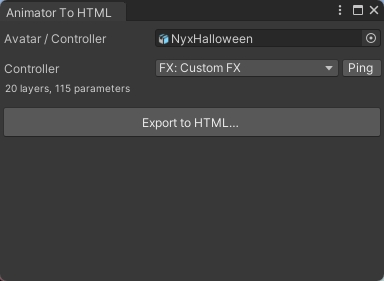
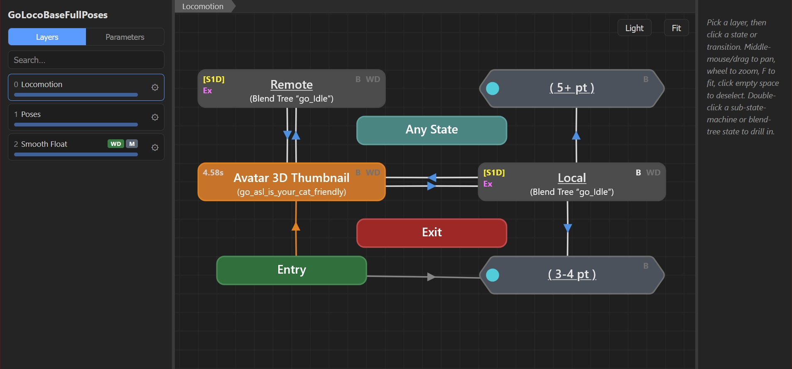

# AnimatorToHTML
Export an avatar's Animator Controllers, or a single controller, to a self-contained interactive HTML page 
The tool can be found it Unity at: ``TohruTheDragon/Animator To HTML``

### The window

  

### The result

  

Get the latest release here: [Link](https://github.com/fkrisi11/AnimatorToHTML/releases/latest)
 
Or download it via VCC: [Link](https://fkrisi11.github.io/VPM-Package-Listing/)
